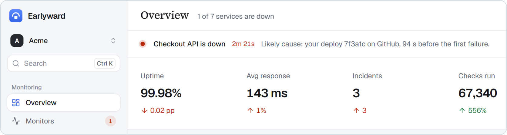

<picture>
  <source media="(prefers-color-scheme: dark)" srcset="assets/poster-dark.svg">
  
</picture>

Product engineer in India. I look for problems people actually have, then build the product that fixes them, from the database to the last pixel.

## Now building

**[Earlyward](https://earlyward.com)**: your customers shouldn't be the ones who tell you the site is down. Earlyward tells you within a minute, and names the likely cause. Live, and free while in beta.

## Shipped

| The problem | What I built |
| :-- | :-- |
| A retry charges the customer twice. | **[IdemPay](https://github.com/Divyamsirswal/IdemPay)** makes each payment go through once, however many times it's sent. |
| A flash sale sells more than you have. | **[Surge](https://github.com/Divyamsirswal/Surge)** sells exactly what's in stock, even when everyone hits buy at once. |
| One client floods your API and slows it for everyone. | **[flux-limiter](https://github.com/Divyamsirswal/flux-limiter)** keeps one fair limit across every server. |

## How I work

**Start from the problem.** The stack comes after. 
**Ship the smallest thing that fixes it,** then let real use shape the rest. 
**Make it boring to run.** Retries, limits and alerts come first, not last.

**Have a problem worth solving?** [Email me](mailto:divyamsirswal361@gmail.com) · [LinkedIn](https://linkedin.com/in/divyamsirswal) · [earlyward.com](https://earlyward.com)
